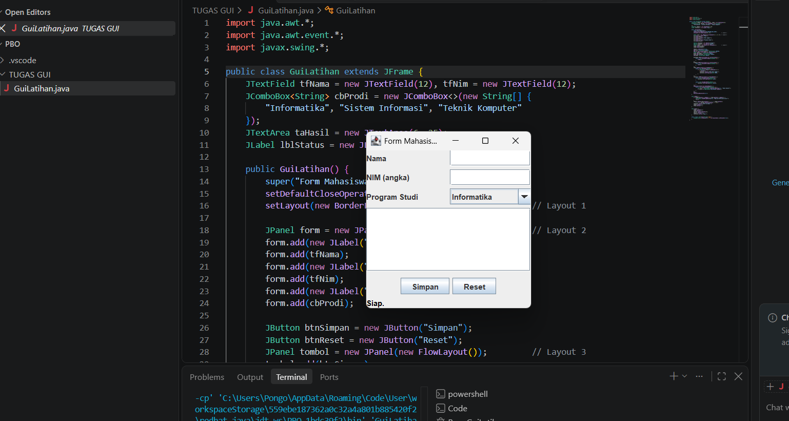
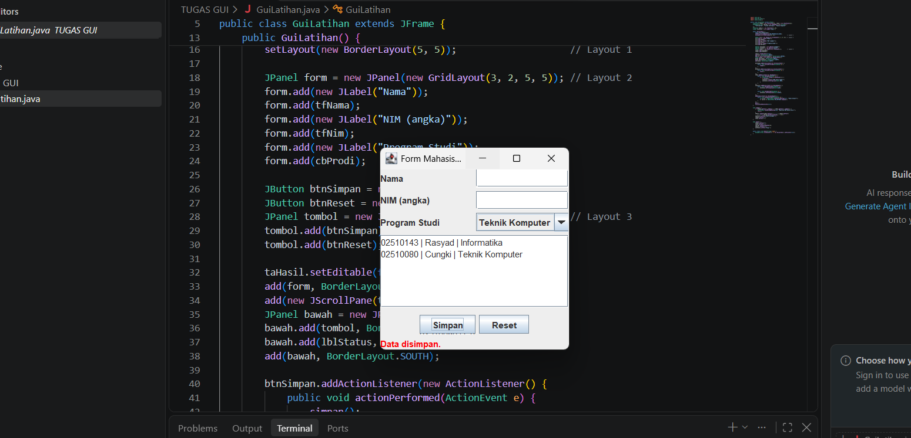

# GUI_Form-Mahasiswa
# Latihan GUI Java (Swing) - Form Mahasiswa

- NIM: F1D02510143
- Nama: MUHAMAD RASYAD AL-KAUTSAR
- Mata Kuliah: Pemrograman Berorientasi Objek (PBO)

## Deskripsi

Program ini adalah latihan/eksplorasi *Graphical User Interface* (GUI)
pada Java menggunakan **Java Swing**. Pengguna mengisi Nama, NIM, dan
Program Studi, lalu data ditampilkan pada daftar "Data tersimpan".

## Fitur

- Input Nama dan NIM, serta pilihan Program Studi.
- Tombol **Simpan** menambahkan data ke area hasil.
- Tombol **Reset** mengosongkan form dan area hasil.
- Validasi: kolom NIM hanya menerima angka.
- Validasi: Nama dan NIM tidak boleh kosong saat Simpan.
- Konfirmasi sebelum jendela ditutup.

## Struktur Repositori

```
.
├── GuiLatihan.java      # kode program
├── README.md            # dokumentasi
└── screenshots/         # tangkapan layar program
```

## Cara Menjalankan

Syarat: JDK 8 atau lebih baru.

```bash
javac GuiLatihan.java
java GuiLatihan
```

Atau buka file di VS Code lalu klik **Run**. Nama file harus
`GuiLatihan.java` agar sama dengan nama class publiknya.

## 5 Komponen Utama GUI

### 1. Top-level Container: `JFrame`
Jendela utama aplikasi (`GuiLatihan extends JFrame`). Semua komponen
lain diletakkan di dalamnya.

### 2. Intermediate Container: `JPanel` dan `JScrollPane`
- `JPanel` mengelompokkan form input dan tombol.
- `JScrollPane` membungkus `JTextArea` agar hasil bisa di-scroll.

### 3. Atomic Component
- `JLabel`: teks label field dan teks status.
- `JTextField`: input Nama dan NIM.
- `JComboBox`: pilihan Program Studi.
- `JButton`: tombol Simpan dan Reset.
- `JTextArea`: menampilkan data yang tersimpan.

### 4. Layout Classes
- `BorderLayout`: membagi frame menjadi utara (form), tengah (hasil),
  dan selatan (tombol dan status).
- `GridLayout`: form 3 baris x 2 kolom agar label dan input rapi.
- `FlowLayout`: tombol Simpan dan Reset berjajar di tengah.

### 5. Event Listener

| Listener | Jenis | Method di-override | Dipasang pada |
|---|---|---|---|
| `ActionListener` | Interface | `actionPerformed` | Tombol Simpan, Reset |
| `KeyAdapter` | Adapter class | `keyTyped` | Kolom NIM |
| `MouseAdapter` | Adapter class | `mouseEntered`, `mouseExited` | Label status |
| `WindowAdapter` | Adapter class | `windowClosing` | `JFrame` |

## Validasi NIM

Kolom NIM divalidasi dengan `KeyAdapter` (method `keyTyped`).
Setiap karakter yang diketik diperiksa memakai `Character.isDigit()`.
Jika bukan angka, karakter dibatalkan dengan `e.consume()` dan label
status menampilkan pesan merah "NIM hanya angka!".

```java
if (!Character.isDigit(e.getKeyChar())) {
    e.consume();
    lblStatus.setText("NIM hanya angka!");
}
```

Selain itu, tombol Simpan menolak data jika Nama atau NIM kosong
dengan menampilkan dialog `JOptionPane`.

## Cara Penggunaan

1. Isi kolom **Nama**.
2. Isi kolom **NIM** (hanya angka).
3. Pilih **Program Studi**.
4. Klik **Simpan**, data muncul di area hasil.
5. Klik **Reset** untuk mengosongkan semuanya.
6. Klik tombol X untuk keluar, lalu konfirmasi dengan **Yes**.

## Screenshot

### 1. Tampilan awal


### 2. Data berhasil disimpan


### 3. Validasi NIM (huruf ditolak)


### 4. Dialog konfirmasi keluar

